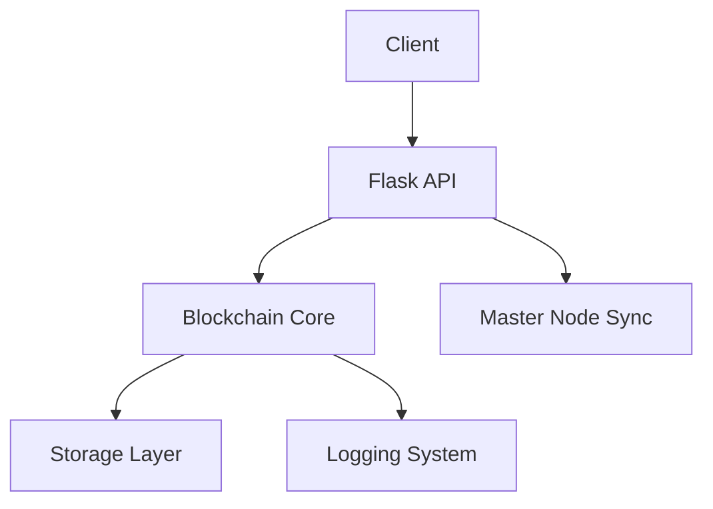

# VM3 Blockchain Node Documentation

## Daftar Isi
1. [Pendahuluan](#pendahuluan)
2. [Struktur Sistem](#struktur-sistem)
3. [Arsitektur Node](#arsitektur-node)
4. [Komponen Utama](#komponen-utama)
5. [Alur Kerja](#alur-kerja)
6. [API Endpoints](#api-endpoints)
7. [Keamanan](#keamanan)
8. [Penyimpanan Data](#penyimpanan-data)
9. [Fitur Tambahan](#fitur-tambahan)
10. [Pengujian dan Monitoring](#pengujian-dan-monitoring)

## Pendahuluan
VM3 adalah node blockchain yang berfungsi sebagai node sekunder dalam jaringan blockchain terdistribusi. Node ini berkomunikasi dengan master node (VM1) untuk menjaga konsistensi data blockchain di seluruh jaringan. Implementasi menggunakan Flask sebagai framework web dan menyediakan API RESTful untuk interaksi dengan blockchain.

### Tujuan
- Menyediakan node sekunder yang reliable
- Menjaga konsistensi data dengan master node
- Menyediakan akses API untuk interaksi dengan blockchain
- Memastikan keamanan dan integritas data

### Teknologi yang Digunakan
- Python 3.x
- Flask Framework
- JSON untuk penyimpanan data
- SHA-256 untuk hashing
- RESTful API

## Struktur Sistem

### Struktur Direktori
```
.
├── app/                    # Direktori utama aplikasi
│   ├── __init__.py        # Inisialisasi aplikasi Flask
│   ├── blockchain/        # Implementasi blockchain
│   │   ├── __init__.py
│   │   └── blockchain.py  # Kelas Blockchain
│   ├── api/              # Endpoint API
│   │   ├── __init__.py
│   │   └── routes.py     # Definisi route API
│   └── services/         # Layanan tambahan
├── data/                 # Penyimpanan data blockchain
│   └── blockchain/       # File blockchain dan blocks
├── logs/                # File log aplikasi
├── tests/              # Unit test
├── venv/              # Virtual environment Python
├── run.py            # Entry point aplikasi
└── clean_blockchain.py # Script untuk membersihkan blockchain
```

### Komponen Sistem
1. **Aplikasi Web (Flask)**
   - Menangani request HTTP
   - Menyediakan API endpoints
   - Mengelola state aplikasi

2. **Blockchain Core**
   - Implementasi logika blockchain
   - Manajemen chain dan blocks
   - Validasi data

3. **Storage Layer**
   - Persistensi data ke file
   - Manajemen file dan direktori
   - Backup dan recovery

4. **Logging System**
   - Log aplikasi
   - Error tracking
   - Audit trail

## Arsitektur Node

### Komponen Arsitektur


### Flow Data
1. Request masuk melalui API
2. Validasi dan autentikasi
3. Pemrosesan di blockchain core
4. Persistensi ke storage
5. Response ke client

## Komponen Utama

### 1. Blockchain Implementation
```python
class Blockchain:
    def __init__(self):
        self.chain = []
        self.chain_file = 'data/blockchain/chain.json'
        self.blocks_dir = 'data/blockchain/blocks'
        self._ensure_directories()
        self.load_chain()

    def add_block(self, block_data):
        try:
            if isinstance(block_data, dict) and 'index' in block_data:
                index = block_data['index']
                previous_hash = block_data.get('previous_hash', '0')
                timestamp = block_data.get('timestamp', datetime.now().timestamp())
                data = block_data.get('data', block_data)
            else:
                index = len(self.chain)
                previous_hash = self.chain[-1]['hash'] if self.chain else '0'
                timestamp = datetime.now().timestamp()
                data = block_data

            new_block = {
                'index': index,
                'timestamp': timestamp,
                'data': data,
                'previous_hash': previous_hash,
                'hash': self._calculate_hash(index, timestamp, data, previous_hash)
            }

            self.chain.append(new_block)
            self.save_chain()
            self._save_block_to_file(new_block)
            return new_block
        except Exception as e:
            logging.error(f"Error adding block: {str(e)}")
            return None
```

### 2. API Implementation
```python
@api.route('/api/sync', methods=['POST'])
def sync():
    try:
        master_url = "http://10.41.99.202:5000"
        response = requests.get(f"{master_url}/api/blockchain")
        if response.status_code == 200:
            master_chain = response.json()
            blockchain = current_app.blockchain
            for block in master_chain:
                blockchain.add_block(block)
            return jsonify({
                "status": "success",
                "message": f"Synced {len(master_chain)} blocks from master"
            }), 200
    except Exception as e:
        logging.error(f"Error syncing with master: {str(e)}")
        return jsonify({
            "status": "error",
            "message": str(e)
        }), 500
```

## Alur Kerja

### 1. Sinkronisasi dengan Master Node
1. Request sinkronisasi diterima
2. Mengambil chain dari master node
3. Validasi setiap block
4. Update chain lokal
5. Simpan perubahan

### 2. Penambahan Block Baru
1. Validasi data block
2. Hitung hash block
3. Tambahkan ke chain
4. Simpan ke storage
5. Update log

## API Endpoints

### 1. Health Check
```http
GET /health
Response: {"status": "ok"}
```

### 2. Sinkronisasi
```http
POST /api/sync
Response: {
    "status": "success",
    "message": "Synced X blocks from master"
}
```

### 3. Penyimpanan Block
```http
POST /api/store
Request: {
    "data": {
        "message": "Test Block"
    }
}
Response: {
    "status": "success",
    "block": {
        "index": 1,
        "hash": "...",
        "data": {...}
    }
}
```

## Keamanan

### 1. Validasi Data
- Validasi format block
- Verifikasi hash
- Pengecekan integritas chain

### 2. Error Handling
- Penanganan exception
- Logging error
- Response error yang aman

### 3. Logging
- Audit trail
- Error tracking
- Security events

## Penyimpanan Data

### 1. Struktur Data
```json
{
    "index": 0,
    "timestamp": 1625097600.0,
    "data": {
        "message": "Genesis Block"
    },
    "previous_hash": "0",
    "hash": "a1b2c3d4e5f6..."
}
```

### 2. File Storage
- Chain utama: `data/blockchain/chain.json`
- Block individual: `data/blockchain/blocks/block_X.json`
- Log files: `logs/app.log`

## Fitur Tambahan

### 1. Logging System
```python
logging.basicConfig(
    level=logging.INFO,
    format='%(asctime)s - %(name)s - %(levelname)s - %(message)s',
    handlers=[
        RotatingFileHandler('logs/app.log', maxBytes=10000000, backupCount=5),
        logging.StreamHandler()
    ]
)
```

### 2. Cleanup Script
- Membersihkan blockchain
- Reset state
- Backup data

## Pengujian dan Monitoring

### 1. Health Check
- Status node
- Koneksi ke master
- Integritas chain

### 2. Monitoring
- Log monitoring
- Error tracking
- Performance metrics

### 3. Testing
- Unit tests
- Integration tests
- API tests

## Source Code Lengkap

### 1. `app/__init__.py`
```python
from flask import Flask
from app.api import api
from app.blockchain.blockchain import Blockchain
import logging

def create_app():
    app = Flask(__name__)
    
    # Setup logging
    logging.basicConfig(
        level=logging.INFO,
        format='%(asctime)s - %(name)s - %(levelname)s - %(message)s',
        handlers=[
            logging.FileHandler('logs/app.log'),
            logging.StreamHandler()
        ]
    )
    
    # Initialize blockchain
    blockchain = Blockchain()
    
    # Register blueprints
    app.register_blueprint(api)
    
    # Add blockchain instance to app context
    app.blockchain = blockchain
    
    return app
```

### 2. `app/blockchain/blockchain.py`
```python
import json
import os
import logging
from datetime import datetime

class Blockchain:
    def __init__(self):
        self.chain = []
        self.chain_file = 'data/blockchain/chain.json'
        self.blocks_dir = 'data/blockchain/blocks'
        self._ensure_directories()
        self.load_chain()

    def _ensure_directories(self):
        """Ensure required directories exist"""
        os.makedirs(os.path.dirname(self.chain_file), exist_ok=True)
        os.makedirs(self.blocks_dir, exist_ok=True)

    def load_chain(self):
        """Load blockchain from file"""
        try:
            if os.path.exists(self.chain_file):
                with open(self.chain_file, 'r') as f:
                    self.chain = json.load(f)
                logging.info(f"Loaded chain with {len(self.chain)} blocks")
            else:
                self.chain = []
                self.save_chain()
                logging.info("Created new empty chain")
        except Exception as e:
            logging.error(f"Error loading chain: {str(e)}")
            self.chain = []

    def save_chain(self):
        """Save blockchain to file"""
        try:
            with open(self.chain_file, 'w') as f:
                json.dump(self.chain, f, indent=2)
            logging.info("Chain saved successfully")
        except Exception as e:
            logging.error(f"Error saving chain: {str(e)}")

    def add_block(self, block_data):
        """Add a new block to the chain"""
        try:
            # If block_data is a dict with index, use it
            if isinstance(block_data, dict) and 'index' in block_data:
                index = block_data['index']
                previous_hash = block_data.get('previous_hash', '0')
                timestamp = block_data.get('timestamp', datetime.now().timestamp())
                data = block_data.get('data', block_data)
            else:
                # If no index provided, add at the end
                index = len(self.chain)
                previous_hash = self.chain[-1]['hash'] if self.chain else '0'
                timestamp = datetime.now().timestamp()
                data = block_data

            new_block = {
                'index': index,
                'timestamp': timestamp,
                'data': data,
                'previous_hash': previous_hash,
                'hash': self._calculate_hash(index, timestamp, data, previous_hash)
            }

            self.chain.append(new_block)
            self.save_chain()
            self._save_block_to_file(new_block)
            logging.info(f"Added block at index {index}")
            return new_block
        except Exception as e:
            logging.error(f"Error adding block: {str(e)}")
            return None

    def _calculate_hash(self, index, timestamp, data, previous_hash):
        """Calculate hash for a block"""
        import hashlib
        block_string = f"{index}{timestamp}{json.dumps(data)}{previous_hash}"
        return hashlib.sha256(block_string.encode()).hexdigest()

    def _save_block_to_file(self, block):
        """Save individual block to file"""
        try:
            filename = f"{self.blocks_dir}/block_{block['index']}.json"
            with open(filename, 'w') as f:
                json.dump(block, f, indent=2)
        except Exception as e:
            logging.error(f"Error saving block to file: {str(e)}")

    def get_chain(self):
        """Get the entire blockchain"""
        return self.chain

    def get_latest_block(self):
        """Get the latest block in the chain"""
        return self.chain[-1] if self.chain else None
```

### 3. `app/api/routes.py`
```python
from flask import Blueprint, jsonify, request, current_app
import requests
import logging

api = Blueprint('api', __name__)

@api.route('/health', methods=['GET'])
def health():
    return jsonify({"status": "ok"}), 200

@api.route('/api/sync', methods=['POST'])
def sync():
    """Sync blockchain with master node"""
    try:
        # Get master node URL from config
        master_url = "http://10.41.99.202:5000"  # Updated VM1 IP and port
        
        logging.info(f"Attempting to sync with master node at {master_url}")
        
        # Get chain from master
        response = requests.get(f"{master_url}/api/blockchain")
        if response.status_code == 200:
            master_chain = response.json()
            logging.info(f"Successfully retrieved {len(master_chain)} blocks from master")
            
            # Update local chain
            blockchain = current_app.blockchain
            for block in master_chain:
                logging.info(f"Processing block {block.get('index')} from master")
                blockchain.add_block(block)
            
            return jsonify({
                "status": "success",
                "message": f"Synced {len(master_chain)} blocks from master"
            }), 200
        else:
            logging.error(f"Failed to sync with master: HTTP {response.status_code}")
            return jsonify({
                "status": "error",
                "message": f"Failed to sync with master: {response.status_code}"
            }), 500
    except Exception as e:
        logging.error(f"Error syncing with master: {str(e)}")
        return jsonify({
            "status": "error",
            "message": str(e)
        }), 500

@api.route('/api/store', methods=['POST'])
def store_block():
    """Store a new block received from master node"""
    try:
        block_data = request.get_json()
        if not block_data:
            logging.error("No block data provided in request")
            return jsonify({
                "status": "error",
                "message": "No block data provided"
            }), 400

        logging.info(f"Received block data: {block_data}")
        
        blockchain = current_app.blockchain
        new_block = blockchain.add_block(block_data)
        
        if new_block:
            logging.info(f"Successfully stored block {new_block['index']}")
            return jsonify({
                "status": "success",
                "message": f"Block {new_block['index']} stored successfully",
                "block": new_block
            }), 200
        else:
            logging.error("Failed to store block")
            return jsonify({
                "status": "error",
                "message": "Failed to store block"
            }), 500
    except Exception as e:
        logging.error(f"Error storing block: {str(e)}")
        return jsonify({
            "status": "error",
            "message": str(e)
        }), 500

@api.route('/api/blockchain', methods=['GET'])
def get_chain():
    """Get the entire blockchain"""
    try:
        blockchain = current_app.blockchain
        chain = blockchain.get_chain()
        logging.info(f"Retrieved chain with {len(chain)} blocks")
        return jsonify(chain), 200
    except Exception as e:
        logging.error(f"Error getting chain: {str(e)}")
        return jsonify({
            "status": "error",
            "message": str(e)
        }), 500
```

### 4. `run.py`
```python
from app import create_app
import logging
import os
from logging.handlers import RotatingFileHandler

# Setup logging
if not os.path.exists('logs'):
    os.makedirs('logs')

logging.basicConfig(
    level=logging.INFO,
    format='%(asctime)s - %(name)s - %(levelname)s - %(message)s',
    handlers=[
        RotatingFileHandler('logs/app.log', maxBytes=10000000, backupCount=5),
        logging.StreamHandler()
    ]
)

try:
    app = create_app()
    if __name__ == '__main__':
        app.run(host='0.0.0.0', port=5002, debug=True)
except Exception as e:
    logging.error(f"Error starting application: {str(e)}")
    raise
```

### 5. `clean_blockchain.py`
```python
import os
import shutil
import logging

def clean_blockchain():
    """Clean blockchain data and logs"""
    try:
        # Clean blockchain data
        blockchain_dir = 'data/blockchain'
        if os.path.exists(blockchain_dir):
            shutil.rmtree(blockchain_dir)
            os.makedirs(blockchain_dir)
            logging.info("Cleaned blockchain data directory")

        # Clean logs
        logs_dir = 'logs'
        if os.path.exists(logs_dir):
            for file in os.listdir(logs_dir):
                if file.endswith('.log'):
                    os.remove(os.path.join(logs_dir, file))
            logging.info("Cleaned log files")

        logging.info("Blockchain cleanup completed successfully")
    except Exception as e:
        logging.error(f"Error cleaning blockchain: {str(e)}")
        raise

if __name__ == '__main__':
    # Setup logging
    logging.basicConfig(
        level=logging.INFO,
        format='%(asctime)s - %(name)s - %(levelname)s - %(message)s',
        handlers=[
            logging.StreamHandler()
        ]
    )
    
    clean_blockchain()
```

### 6. `app/api/__init__.py`
```python
from app.api.routes import api
```

### 7. `app/blockchain/__init__.py`
```python
# Empty file to mark directory as Python package
```

### Struktur Data

#### Contoh Block
```json
{
    "index": 0,
    "timestamp": 1625097600.0,
    "data": {
        "message": "Genesis Block"
    },
    "previous_hash": "0",
    "hash": "a1b2c3d4e5f6..."
}
```

#### Contoh API Response
```json
{
    "status": "success",
    "message": "Block 1 stored successfully",
    "block": {
        "index": 1,
        "timestamp": 1625097600.0,
        "data": {
            "message": "Test Block"
        },
        "previous_hash": "a1b2c3d4e5f6...",
        "hash": "b2c3d4e5f6g7..."
    }
}
```

#### Contoh Error Response
```json
{
    "status": "error",
    "message": "Failed to sync with master: Connection refused"
}
``` 